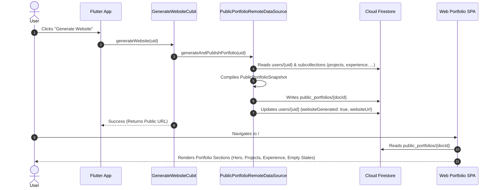

# ConnectHub 🌐🚀

[](https://flutter.dev)
[](https://dart.dev)
[](https://firebase.google.com)
[](https://fastapi.tiangolo.com)
[](https://ai.google.dev)
[](https://bloclibrary.dev)
[](LICENSE)

> **ConnectHub** is an enterprise-grade social networking and AI-augmented professional portfolio platform. It unites interactive social networking (newsfeeds, media sharing, commenting, following, real-time messaging, and smart notifications) with an automated AI portfolio pipeline. ConnectHub parses uploaded CV documents using Google Gemini, synchronizes user credentials, and deploys high-performance, responsive public portfolio websites to Firebase Hosting with zero data hallucination.

---

## 📑 Table of Contents

- [Project Overview](#-project-overview)
- [Key Features](#-key-features)
  - [Authentication & Identity](#-authentication--identity)
  - [Social Networking & Feed](#-social-networking--feed)
  - [Conversations & Real-Time Chat](#-conversations--real-time-chat)
  - [In-App Notifications](#-in-app-notifications)
  - [Professional Portfolio Management](#-professional-portfolio-management)
  - [AI CV Parser Engine](#-ai-cv-parser-engine)
  - [Web Portfolio & Website Generator](#-web-portfolio--website-generator)
  - [AI Assistant Chatbot](#-ai-assistant-chatbot)
  - [Search & Discovery](#-search--discovery)
  - [Account Management & Cascading Cleanup](#-account-management--cascading-cleanup)
- [Technology Stack](#-technology-stack)
- [System Architecture](#-system-architecture)
  - [Flutter Clean Architecture](#flutter-clean-architecture)
  - [AI Engine Backend Architecture](#ai-engine-backend-architecture)
  - [Public Portfolio Publishing Flow](#public-portfolio-publishing-flow)
- [Repository Structure](#-repository-structure)
- [Firebase & Cloud Firestore Schema](#-firebase--cloud-firestore-schema)
- [AI Engine (FastAPI & Gemini)](#-ai-engine-fastapi--gemini)
  - [API Endpoints](#api-endpoints)
  - [Validation & Zero-Hallucination Policy](#validation--zero-hallucination-policy)
- [Website Generation & Hosting](#-website-generation--hosting)
- [Installation & Local Setup](#-installation--local-setup)
  - [Prerequisites](#prerequisites)
  - [Flutter Client Setup](#flutter-client-setup)
  - [AI Backend Setup](#ai-backend-setup)
  - [Firebase Configuration](#firebase-configuration)
- [Deployment](#-deployment)
  - [Firebase Hosting Deployment](#firebase-hosting-deployment)
  - [Dockerized Backend Deployment](#dockerized-backend-deployment)
- [Security & Access Control](#-security--access-control)
- [Future Roadmap](#-future-roadmap)
- [Screenshots](#-screenshots)
- [License](#-license)

---

## 🌟 Project Overview

ConnectHub bridges the gap between interactive social engagement and professional portfolio presentation:

1. **Social Networking Experience:** Allows developers, engineers, and creators to share posts, attach photos, comment in nested threads, like updates, follow other professionals, and chat in private direct messages.
2. **AI-Driven Portfolio Generation:** Users upload their existing PDF CVs. The FastAPI microservice extracts raw text with PyMuPDF, processes it through Google Gemini 2.5 Flash, validates the output with strict Pydantic schemas, and populates structured projects, experiences, skills, education, and certificates.
3. **Instant Website Publishing:** Generates and publishes an animated, luxury single-page web portfolio hosted on Firebase Hosting with a personalized canonical URL (`https://connecthub-57eb5.web.app/#/portfolio/{username}`).
4. **Zero-Hallucination Integrity:** Guaranteed fidelity where missing sections display clean empty states rather than injected mock or synthetic data.

---

## 🚀 Key Features

### 🔐 Authentication & Identity
- **Dual Account Modes:** Select between **Personal** and **Professional** accounts upon registration.
- **Email & Password Authentication:** Handled securely via Firebase Auth.
- **Session Persistence:** Auto-login on launch via secure authentication state streams.
- **Slug Generation:** Automatic initial slug generation (`profileSlug`) from the user's name for URL-friendly portfolio routing.
- **Profile Customization:** Headline, bio, background ("About"), location, phone number, profile image, and custom social link entries (GitHub, LinkedIn, Website, custom channels).

### 📰 Social Networking & Feed
- **Live Activity Feed:** Real-time post synchronization sorted by recency.
- **Media Attachments:** Upload image attachments via the integrated ImgBB API service.
- **Interactive Reactions:** Real-time post liking with dynamic counter increments and optimistic UI updates.
- **Comment Threads:** Nested comment streams attached to posts with author avatars, timestamps, and immediate deletion capabilities for comment owners or post creators.
- **Social Graph (Follow / Unfollow):** Real-time follower/following relationship tracking with transactional count adjustments.

### 💬 Conversations & Real-Time Chat
- **1-on-1 Direct Messaging:** Private chat channels stored under `/conversations/{conversationId}/messages`.
- **Soft Deletion & Read Receipts:** Support for message status flags (`seenBy`, `deletedFor`), timestamp indicators, and unread badges.
- **Real-Time Synchronization:** Listens to Firestore snapshots for zero-latency communication.

### 🔔 In-App Notifications
- **Triggered Events:** Automatic notification delivery when another user follows you, likes your post, or comments on your thread.
- **Actionable Notification Feed:** Mark notifications as read, view sender details, and navigate directly to target content.

### 💼 Professional Portfolio Management
- **Structured Categories:** Dedicated management for:
  - **Projects:** Title, description, technologies/tags, GitHub repo link, live demo URL, date, and visibility toggle.
  - **Work Experience:** Role title, company name, location, date range, description, and visibility toggle.
  - **Education:** Degree, institution, field of study, start/end dates.
  - **Certificates:** Name, issuing organization, issue date, credential ID, and verification link.
  - **Skills:** Individual tags and technical skills.
- **Section Visibility Controls:** Granular toggle options per section (`about`, `experience`, `projects`, `skills`, `education`, `certificates`).

### 🤖 AI CV Parser Engine
- **PDF Extraction:** Extracts text accurately from uploaded CVs using PyMuPDF.
- **Gemini 2.5 Flash Processing:** Parses unstructured resume text into strictly typed JSON structures.
- **Zero-Hallucination Filtering:** Strict fidelity validation ensures no unmentioned projects, companies, or credentials are added.
- **Interactive Review:** Review and edit parsed portfolio data before committing to Firestore.

### 🌐 Web Portfolio & Website Generator
- **One-Click Publishing:** Aggregates user profile data and subcollections into an optimized `public_portfolios` snapshot.
- **Permanent Public URL:** Canonical routing format `/#/portfolio/{username}`.
- **High-End UI/UX:** Dark luxury theme, gold shimmer animations, typing titles, tilt hover cards, animated counters, and fluid responsiveness across Mobile, Tablet, Laptop, and Desktop.
- **Clean Empty States:** Sections without user data display elegant empty states rather than mock/fabricated cards.

### 🧠 AI Assistant Chatbot
- **Interactive Companion:** In-app AI chatbot available for user inquiries, career advice, and general questions.
- **Automated Webhook Integration:** Communicates over Dio with an n8n automated AI workflow endpoint.

### 🔍 Search & Discovery
- **User Discovery:** Search users by username or display name.
- **Content Search:** Search posts across the network.

### 🗑️ Account Management & Cascading Cleanup
- **Complete Account Deletion Service:** Full cascade cleanup removing:
  - User document (`/users/{uid}`)
  - Subcollections (`projects`, `experience`, `education`, `certificates`, `followers`, `following`, `notifications`)
  - User-authored posts and post comments
  - Comments across other users' posts
  - Conversations, private messages, and notifications sent to other users
  - Associated public portfolio snapshots (`/public_portfolios/{docId}`)
  - Firebase Authentication account

---

## 🛠️ Technology Stack

### **Frontend & Client (Flutter)**
| Technology | Version / Spec | Purpose |
| :--- | :--- | :--- |
| **Flutter SDK** | `^3.12.2` (Dart 3.x) | Cross-platform UI toolkit (Mobile, Desktop & Web) |
| **flutter_bloc** | `^9.1.1` | State management using Cubit & BLoC patterns |
| **firebase_core** | `^3.13.0` | Firebase initialization & platform configurations |
| **firebase_auth** | `^5.7.0` | User authentication & session handling |
| **cloud_firestore** | `^5.6.7` | Real-time NoSQL database |
| **dio** | `^5.11.1` | HTTP client for AI microservices & external APIs |
| **cached_network_image** | `^3.4.1` | Image caching & memory optimization |
| **google_fonts** | `^8.2.1` | Premium typography |
| **url_launcher** | `^6.3.1` | External URL launching for portfolio projects & links |
| **file_picker** | `^13.1.0` | Local CV PDF selection |
| **image_picker** | `^1.1.2` | Camera & gallery photo selection |
| **flutter_secure_storage**| `^11.2.0` | Encrypted local key storage |
| **share_plus** | `^13.3.1` | Native sharing of public portfolio links |

### **AI Backend Microservice (Python & FastAPI)**
| Technology | Version / Spec | Purpose |
| :--- | :--- | :--- |
| **FastAPI** | `0.115.6` | High-performance asynchronous REST API framework |
| **Uvicorn** | `0.32.1` | ASGI production web server |
| **Google Generative AI** | `0.8.3` | Gemini 2.5 Flash SDK integration |
| **Pydantic** | `2.10.4` | Data parsing, type safety, and schema validation |
| **PyMuPDF (fitz)** | `1.25.1` | High-speed PDF plain text extraction & sanitization |
| **Firebase Admin SDK** | `6.6.0` | Server-side Firebase service account operations |
| **structlog** | `24.4.0` | Structured JSON application logging |
| **tenacity** | `9.0.0` | Resilient retry policies with exponential backoff |
| **pytest & pytest-asyncio**| `8.3.4` / `0.25.0` | Comprehensive test suite & automated fidelity verification |

---

## 🏛️ System Architecture

### Flutter Clean Architecture

ConnectHub is organized according to **Feature-First Clean Architecture**, isolating business rules from platform implementations.


---

### AI Engine Backend Architecture

```mermaid
graph LR
    CLIENT["Flutter Client"] -->|Upload CV (PDF)| ROUTER["FastAPI Router: /portfolio"]
    ROUTER --> SERVICE["PortfolioService"]
    SERVICE --> PDF["PyMuPDF Text Extractor"]
    PDF --> PROMPT["Portfolio Prompt Builder"]
    PROMPT --> GEMINI["Google Gemini 2.5 Flash"]
    GEMINI --> VALIDATOR["ValidationService (Zero-Hallucination)"]
    VALIDATOR --> SCHEMA["Pydantic CVPortfolio Schema"]
    SCHEMA --> CLIENT
```

---

### Public Portfolio Publishing Flow



---

## 📁 Repository Structure

```text
connecthub/
├── .firebase/                       # Firebase deployment cache and hosting configs
├── android/                         # Native Android host project
├── ios/                             # Native iOS host project
├── web/                             # Flutter Web host runner, index.html, manifest
├── windows/                         # Native Windows desktop host project
├── firebase.json                    # Firebase Hosting & Firestore configuration
├── firestore.rules                  # Production Cloud Firestore Security Rules
├── firestore.indexes.json           # Composite index definitions
├── pubspec.yaml                     # Flutter dependencies & metadata
│
├── connecthub-ai/                   # FastAPI & Gemini 2.5 AI Microservice
│   ├── app/
│   │   ├── config/                  # App settings & pydantic environment configs
│   │   ├── core/                    # Security, rate limiter, custom exceptions
│   │   ├── dependencies/            # FastAPI dependency injections
│   │   ├── middleware/              # Timing, error handling, and audit middlewares
│   │   ├── prompts/                 # Prompt templates for Gemini AI
│   │   ├── routers/                 # Endpoints: /portfolio, /ai, /health
│   │   ├── schemas/                 # Pydantic request/response schemas
│   │   ├── services/                # Business logic: portfolio, gemini, validation
│   │   └── utils/                   # Structured logger, text sanitizers
│   ├── tests/                       # Pytest unit & integration test suite
│   ├── Dockerfile                   # Production multi-stage Docker container
│   ├── requirements.txt             # Python dependencies
│   └── .env.example                 # Environment variables reference
│
├── lib/                             # Flutter Application Source Code
│   ├── main.dart                    # Application entry point (Mobile vs Web router switch)
│   ├── firebase_options.dart        # Platform Firebase configuration
│   │
│   ├── core/                        # Global shared core utilities
│   │   ├── config/                  # PortfolioConfig, canonical URLs
│   │   ├── errors/                  # Exceptions & failures definitions
│   │   ├── services/                # AccountDeletionService, ImgBB, AIChatService
│   │   └── utils/                   # Theme tokens, styles, date helpers
│   │
│   ├── features/                    # Feature-First Modular Structure
│   │   ├── auth/                    # Sign-up, Login, AccountTypeSelection
│   │   ├── chat/                    # 1-to-1 conversations & messaging
│   │   ├── chatbot/                 # In-app AI companion chat interface
│   │   ├── follow/                  # Followers & following lists
│   │   ├── generate_website/        # Website generation cubit, use case & dialog
│   │   ├── home/                    # Activity feed & bottom navigation
│   │   ├── notification/            # Real-time notification feed & unread badges
│   │   ├── portfolio/               # Portfolio details, editor, setup, subcollections
│   │   ├── portfolio_import/        # CV PDF upload, AI review & Firestore import
│   │   ├── post/                    # Create post, edit post, comments, likes
│   │   ├── profile/                 # User profiles, statistics & settings triggers
│   │   ├── search/                  # Global search (users & posts)
│   │   ├── settings/                # Account settings & cascade deletion UI
│   │   └── splash/                  # Initial splash screen & session router
│   │
│   └── web_portfolio/               # Standalone Web Portfolio SPA Experience
│       ├── animations/              # Gold shimmer, typing animations, counters
│       ├── data/                    # Web portfolio repositories & snapshot datasources
│       ├── domain/                  # LoadPortfolioUseCase
│       ├── models/                  # PortfolioViewData presentation models
│       ├── pages/                   # WebPortfolioPage, loading & error views
│       ├── responsive/              # Responsive breakpoints & responsive containers
│       ├── sections/                # 9 Sections: Hero, About, Skills, Experience,
│       │                            # Projects, Education, Certificates, Contact, Footer
│       ├── services/                # PortfolioWebService
│       ├── theme/                   # WebColors, WebTheme, WebTextStyles
│       ├── widgets/                 # GlassCard, SectionEmptyState, TechBadge
│       └── portfolio_router.dart    # Web URL hash & path routing parser
│
└── tool/                            # Administrative & migration scripts
    ├── seed_firestore.dart          # Database seeding script for demo data
    └── clear_demo_data.dart         # Database cleanup utility
```

---

## 🗄️ Firebase & Cloud Firestore Schema

### Collection Layout

```text
databases/(default)/documents/
├── users/ {userId}
│   │   Fields: uid, name, email, username, profileSlug, headline, bio, about,
│   │           location, phone, profileImage, skills, socialLinks, accountType,
│   │           websiteGenerated, websiteUrl, followersCount, followingCount, createdAt
│   │
│   ├── projects/ {projectId}
│   │       Fields: title, description, tags, projectUrl, githubUrl, date, isVisible
│   │
│   ├── experience/ {experienceId}
│   │       Fields: title, company, location, startDate, endDate, isCurrent, isVisible
│   │
│   ├── education/ {educationId}
│   │       Fields: degree, institution, fieldOfStudy, startDate, endDate, isVisible
│   │
│   ├── certificates/ {certificateId}
│   │       Fields: name, organization, issueDate, credentialUrl, isVisible
│   │
│   ├── followers/ {followerId}
│   │       Fields: uid, createdAt
│   │
│   ├── following/ {followingId}
│   │       Fields: uid, createdAt
│   │
│   └── notifications/ {notificationId}
│           Fields: id, senderId, receiverId, type, postId, title, body, isRead, createdAt
│
├── posts/ {postId}
│   │   Fields: id, userId, userName, userImage, content, imageUrl,
│   │           likes, likeCount, commentCount, createdAt
│   │
│   └── comments/ {commentId}
│           Fields: id, postId, userId, userName, userImage, content, createdAt
│
├── conversations/ {conversationId}
│   │   Fields: participants, lastMessage, lastMessageTime, unreadCounts
│   │
│   └── messages/ {messageId}
│           Fields: senderId, receiverId, content, mediaUrl, seenBy, deletedFor, createdAt
│
└── public_portfolios/ {docId}
        Fields: uid, username, profileSlug, displayName, name, email, headline, bio,
                about, location, phone, profileImage, resumeUrl, skills, socialLinks,
                projects, experience, education, certificates, publicPortfolioUrl,
                isPublic, version, websiteVersion, generatedAt, updatedAt
```

---

## 🤖 AI Engine (FastAPI & Gemini)

The AI Engine microservice resides in `connecthub-ai` and handles all complex document parsing and generative AI features.

### API Endpoints

| Method | Endpoint | Description |
| :--- | :--- | :--- |
| `GET` | `/health` | Liveness check reporting version and service status |
| `GET` | `/health/ready` | Readiness check validating Gemini API key availability |
| `POST`| `/portfolio/upload-cv` | Accepts a multipart CV PDF, extracts plain text, parses structured portfolio with Gemini, and validates response schema |
| `POST`| `/portfolio/generate-website` | Structures portfolio data strictly for web display with zero fabrication |

### Validation & Zero-Hallucination Policy
- **PyMuPDF Text Sanitizer:** Cleans corrupt bytes, strips null characters, and enforces a maximum text length (100,000 characters).
- **Gemini System Directives:** Prompts explicitly demand extraction **strictly** from visible text.
- **Validation Layer (`validation_service.py`):** Cross-checks output fields against original CV text. If hallucinated skills, projects, or experiences are introduced, the validation layer rejects the payload or cleanses the unverified records.

---

## 🌐 Website Generation & Hosting

When a user taps **Generate Website** in ConnectHub:
1. **Snapshot Creation:** Client fetches all real profile fields and visible items from `users/{uid}` and subcollections.
2. **Snapshot Write:** A single denormalized document is written to `public_portfolios/{docId}` (where `docId` is `username` or `profileSlug` or `uid`).
3. **Public URL Assignment:** Generates permanent URL format:
   ```text
   https://connecthub-57eb5.web.app/#/portfolio/{docId}
   ```
4. **Hosting Deployment:** Deployed via **Firebase Hosting**. Unauthenticated web visitors can access public portfolio documents via safe security rules (`allow read: if true;` on `public_portfolios`).
5. **Dynamic Updates:** Whenever a user edits their portfolio and taps "Generate Website" again, the snapshot is updated in place, updating the live website immediately.

---

## 💻 Installation & Local Setup

### Prerequisites
- [Flutter SDK](https://docs.flutter.dev/get-started/install) (`>= 3.12.2`)
- [Dart SDK](https://dart.dev/get-dart)
- [Python](https://www.python.org/downloads/) (`>= 3.10`)
- [Firebase CLI](https://firebase.google.com/docs/cli) (`firebase-tools`)
- [Google Gemini API Key](https://aistudio.google.com/)

---

### Flutter Client Setup

1. **Clone the repository:**
   ```bash
   git clone https://github.com/hossamelshafay/ConnectHub.git
   cd ConnectHub
   ```

2. **Install Flutter dependencies:**
   ```bash
   flutter pub get
   ```

3. **Configure Firebase:**
   Ensure `lib/firebase_options.dart` and `android/app/google-services.json` are present.

4. **Run the Flutter Application:**
   ```bash
   # Run on Mobile (Android / iOS / Windows Desktop)
   flutter run

   # Run on Web (Web Portfolio Preview)
   flutter run -d chrome
   ```

---

### AI Backend Setup

1. **Navigate to the AI backend folder:**
   ```bash
   cd connecthub-ai
   ```

2. **Create a virtual environment:**
   ```bash
   python -m venv .venv
   # Windows:
   .venv\Scripts\activate
   # Linux / macOS:
   source .venv/bin/activate
   ```

3. **Install Python dependencies:**
   ```bash
   pip install -r requirements.txt
   ```

4. **Configure environment variables:**
   Create a `.env` file from `.env.example`:
   ```bash
   cp .env.example .env
   ```
   Provide your Gemini API key:
   ```ini
   GEMINI_API_KEY=your_gemini_api_key_here
   GEMINI_MODEL=gemini-2.5-flash
   ENVIRONMENT=development
   ALLOWED_ORIGINS=["http://localhost:8000","http://127.0.0.1:8000","http://localhost:*"]
   ```

5. **Start the FastAPI backend server:**
   ```bash
   uvicorn app.main:app --host 0.0.0.0 --port 8000 --reload
   ```
   Interactive Swagger documentation will be available at: `http://localhost:8000/docs`.

6. **Run backend test suite:**
   ```bash
   pytest
   ```

---

## 🚢 Deployment

### Firebase Hosting Deployment (Web Portfolio)

To deploy the Web Portfolio SPA to production on Firebase Hosting:

```bash
# 1. Build the production web bundle
flutter build web --release --base-href "/"

# 2. Deploy hosting target to Firebase
firebase deploy --only hosting
```

---

### Dockerized Backend Deployment

The AI microservice includes a production-ready, multi-stage `Dockerfile`:

```bash
cd connecthub-ai

# Build the container
docker build -t connecthub-ai:latest .

# Run the container
docker run -d -p 8000:8000 --env-file .env --name connecthub-ai-service connecthub-ai:latest
```

---

## 🛡️ Security & Access Control

### Firebase Authentication
- Enforces user identity checks on all operational endpoints.
- Client requests verify credentials through Firebase Auth tokens.

### Cloud Firestore Rules Summary
- `/users/{userId}`: Users can only write and delete their own user document. Counter fields (`followersCount`, `followingCount`) can only be modified via controlled delta increments ($\pm 1$).
- `/posts/{postId}`: Only authenticated users can read or write; only post authors can delete posts.
- `/posts/{postId}/comments/{commentId}`: Comment authors or post owners can delete comments.
- `/conversations/{conversationId}`: Only authenticated participants listed in `participants` can read or write.
- `/public_portfolios/{portfolioId}`: **Public read** enabled for web portfolio hosting. Write, update, and delete actions are strictly restricted to the document owner (`request.auth.uid == resource.data.uid`).

---

## 🔮 Future Roadmap

*Items strictly derived from existing codebase hooks, pending TODOs, and architectural phases:*

- [ ] **ImgBB Media Cleanup Hooks:** Implement external hash-based deletion API calls for orphaned post and profile images lacking local deletion hashes (`lib/core/services/image_bb_service.dart`, `lib/features/post/data/repos/post_repo_imp.dart`).
- [ ] **Phase 2 AI Endpoints:**
  - AI Resume Reviewer (`POST /ai/resume/review`).
  - ATS Compatibility Score Analyzer (`POST /ai/ats/analyze`).
  - Tailored Cover Letter Generator (`POST /ai/cover-letter`).
  - Career Advice Companion (`POST /ai/career/advise`).
  - GitHub Repository Analyzer & Auto-Importer (`POST /ai/github/import`).
- [ ] **Android Production Signing:** Replace debug keys with production keystore and signing configuration in `android/app/build.gradle.kts`.

---

## 📸 Screenshots

| Mobile Feed & Social | Web Portfolio (Desktop) | AI CV Import & Review |
| :---: | :---: | :---: |
|  |  |  |

| Direct Messaging | Profile & Setup | Dark Theme Luxury UI |
| :---: | :---: | :---: |
|  |  |  |

---

## 📄 License

This project is licensed under the **MIT License**. See the [LICENSE](LICENSE) file for full details.
