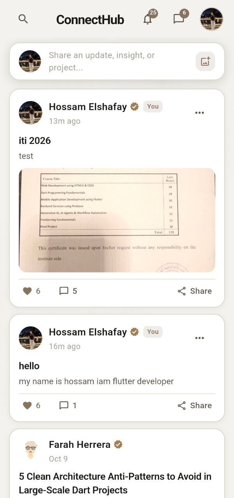
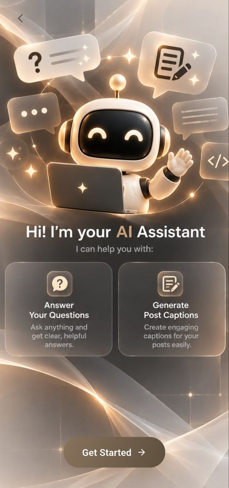
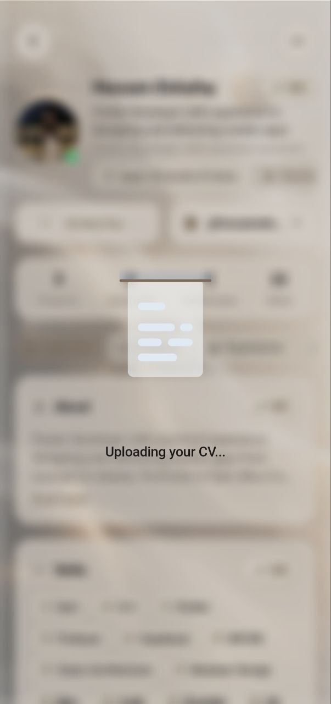
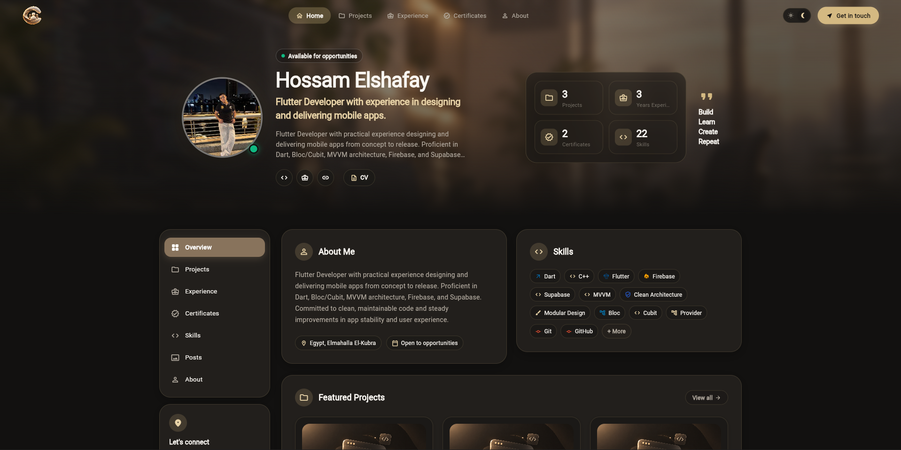
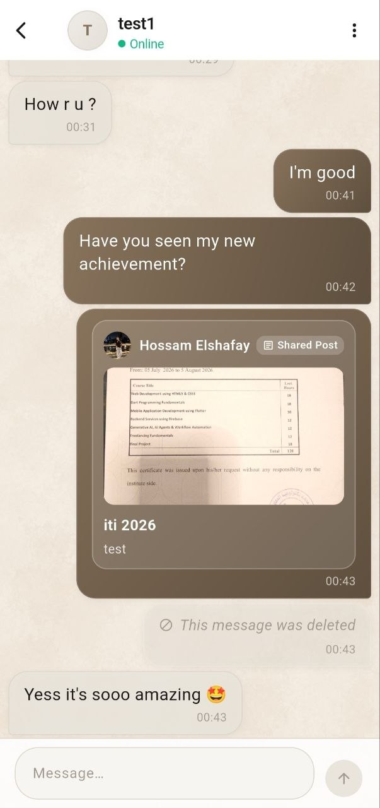
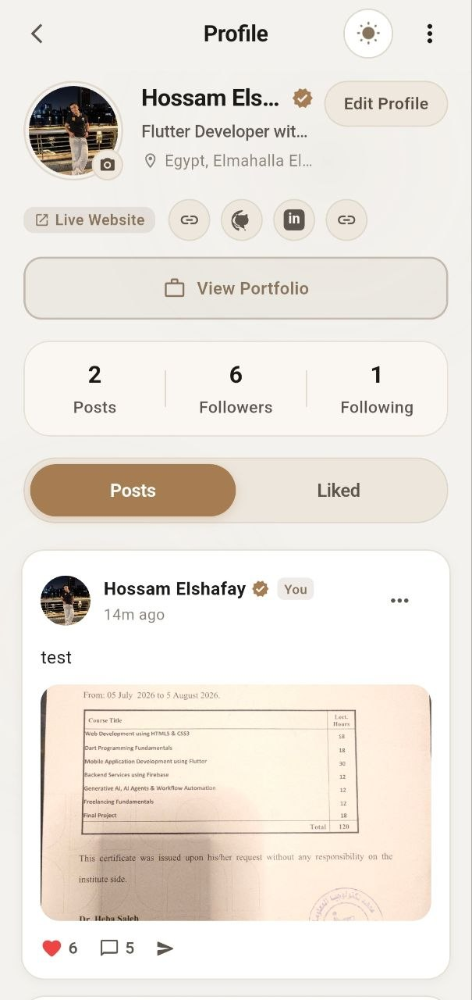
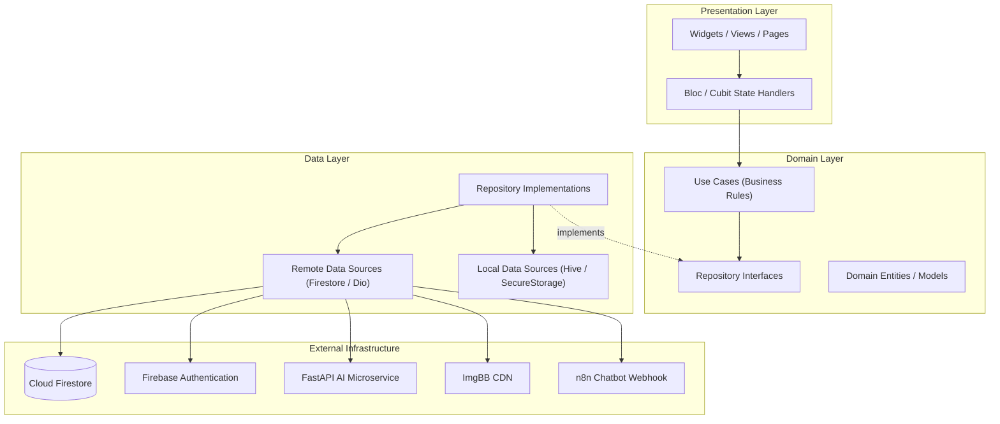
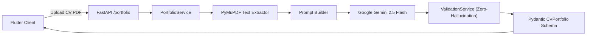
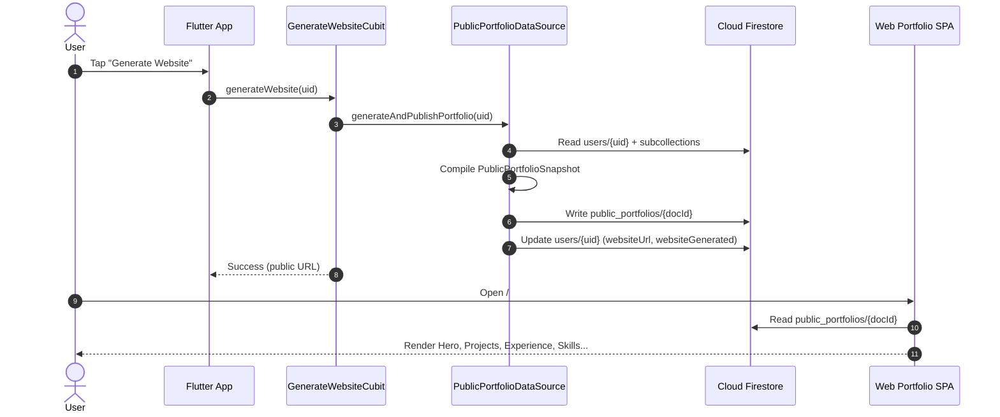

<div align="center">

# ConnectHub

**AI-Powered Social Networking & Professional Portfolio Platform**

[](https://flutter.dev)
[](https://dart.dev)
[](https://firebase.google.com)
[](https://fastapi.tiangolo.com)
[](https://ai.google.dev)
[](https://bloclibrary.dev)
[](LICENSE)
[](https://flutter.dev)

<br/>

> **ConnectHub** is a modern, production-quality cross-platform application that unifies social networking, real-time communication, and AI-powered career tools in a single cohesive experience. Users connect, share, and grow professionally — while AI automates the heavy lifting of portfolio creation, CV analysis, and public website publishing.

<br/>

</div>

---

## 📑 Table of Contents

- [Project Overview](#-project-overview)
- [Screenshots](#-screenshots)
- [Key Features](#-key-features)
- [AI Features](#-ai-features)
- [Tech Stack](#-tech-stack)
- [System Architecture](#-system-architecture)
- [Performance & Optimization](#-performance--optimization)
- [Project Structure](#-project-structure)
- [Firebase & Firestore Schema](#-firebase--cloud-firestore-schema)
- [Installation & Setup](#-installation--local-setup)
- [Deployment](#-deployment)
- [Security & Access Control](#-security--access-control)
- [Why This Project](#-why-this-project)
- [Skills Demonstrated](#-skills-demonstrated)
- [Future Roadmap](#-future-roadmap)
- [License](#-license)

---

## 🌟 Project Overview

ConnectHub bridges the gap between interactive social engagement and professional portfolio presentation across four pillars:

| Pillar | Description |
| :--- | :--- |
| **Social Networking** | Share posts with media, comment in threads, like, follow, and receive real-time notifications |
| **Real-Time Messaging** | Private 1-on-1 chat with read receipts, reply, edit, forward, and delete capabilities |
| **AI Career Tools** | Upload a PDF CV and let Gemini AI extract and structure your entire professional portfolio in seconds |
| **Portfolio Publishing** | One-tap website generation that publishes a live, public-facing portfolio to Firebase Hosting |

The AI pipeline enforces a **zero-hallucination policy** — Gemini output is cross-validated against the original CV text. If data cannot be verified, it is rejected rather than fabricated.

> **Live Portfolio URL format:** `https://connecthub-57eb5.web.app/#/portfolio/{username}`

---

## 📸 Screenshots

| Social Feed | AI Chatbot |
| :---: | :---: |
|  |  |
| **AI CV Analyzer** | **Generated Portfolio Website** |
|  |  |
| **Real-time Chat** | **User Profile** |
|  |  |

---

## 🚀 Key Features

### 🔐 Authentication & Identity
- Email & password authentication via Firebase Auth with persistent session state
- Dual account types: **Personal** and **Professional**, selectable at registration
- Automatic `profileSlug` generation from username for clean portfolio URL routing
- Full profile customization: headline, bio, about, location, phone, social links, profile image
- Change email, change password, and cascading full account deletion

### 📰 Social Feed
- Real-time activity feed sorted by recency with Firestore snapshot listeners
- Create, edit, and delete posts with optional image attachments via ImgBB CDN
- Optimistic like/unlike with live counter updates
- Nested comment threads with timestamps, author avatars, and targeted deletion (author or post owner)
- `@mention` autocomplete overlay and mention-aware text rendering

### 💬 Real-Time Chat
- Private 1-on-1 conversations backed by Firestore streaming
- Per-message actions: reply, edit, forward, delete (soft deletion with `deletedFor` flags)
- Unread message badges and `seenBy` read receipts
- Share posts directly into chat conversations

### 🔔 Notifications
- Real-time notification delivery on follow, post like, and new comment events
- Actionable notification feed with mark-as-read and direct navigation to source content

### 💼 Professional Portfolio
- Structured management for **Projects**, **Work Experience**, **Education**, **Certificates**, and **Skills**
- Per-section visibility toggles (`isVisible`) for granular control over public display
- Portfolio setup wizard for new users
- Pinned tab navigation across portfolio sections

### 🌐 Web Portfolio Generator
- One-tap publishing: aggregates Firestore subcollections into a denormalized `public_portfolios` snapshot
- Generates a permanent, shareable public URL
- Responsive luxury dark-theme SPA: hero with typing animation, gold shimmer effects, tilt hover cards, animated counters, and smooth scroll navigation
- Clean empty states — no fabricated sections when data is missing

### 🔍 Search & Discovery
- Search users by display name or username
- Search posts across the network
- `@mention` suggestion overlay within post composer and comments

### ⚙️ Settings & Account Management
- Change email and password
- **Cascading account deletion:** removes user document, all subcollections, posts, comments, conversations, messages, notifications, and public portfolio snapshots — followed by Firebase Auth deletion

### 🎨 UI / UX Polish
- Adaptive **Dark / Light Mode** with animated theme toggle (no flash on switch)
- Shimmer skeleton screens for every major list and card type
- Lottie JSON animations for AI processing states
- Reusable glass-morphism card and dark glass background components
- Responsive layouts that adapt across Mobile, Tablet, and Desktop

---

## 🤖 AI Features

### AI Chatbot
An in-app conversational AI companion powered by an **n8n automated webhook workflow**. Accessible from the home screen, it answers career questions, gives advice, and responds to general queries via a clean chat interface.

### AI Caption Generator
Generates engaging social media captions for posts using AI, reducing the friction of content creation.

### AI CV Analyzer & Portfolio Parser
The flagship AI feature — a fully automated career tool:

1. **Upload** a PDF CV from the device
2. **Extract** raw text using PyMuPDF (handles complex multi-column layouts)
3. **Parse** with Google Gemini 2.5 Flash using a strict structured prompt
4. **Validate** output against the original CV text (zero-hallucination policy)
5. **Review** the parsed data interactively before confirming
6. **Import** directly into Firestore — projects, experience, education, certificates, and skills are all populated automatically

### AI Portfolio Website Generator
Once the portfolio is populated, a single tap:
- Compiles all visible profile data and subcollections
- Writes a denormalized Firestore snapshot to `public_portfolios`
- Assigns a permanent canonical URL
- The web SPA (also built in Flutter) reads this snapshot and renders a high-end public portfolio page — instantly live on Firebase Hosting

---

## 🛠️ Tech Stack

### Frontend — Flutter Client

| Technology | Version | Purpose |
| :--- | :--- | :--- |
| **Flutter SDK** | `^3.12.2` | Cross-platform UI (Mobile, Web, Desktop) |
| **Dart** | `3.x` | Primary programming language |
| **flutter_bloc** | `^9.1.1` | State management — Cubit & BLoC |
| **firebase_core** | `^3.13.0` | Firebase SDK initialization |
| **firebase_auth** | `^5.7.0` | Authentication & session management |
| **cloud_firestore** | `^5.6.7` | Real-time NoSQL database & streams |
| **firebase_storage** | latest | Profile image & media storage |
| **cached_network_image** | `^3.4.1` | Network image caching & memory optimization |
| **hive / hive_flutter** | latest | Local offline caching |
| **dio** | `^5.11.1` | HTTP client for AI microservices & CDN APIs |
| **lottie** | `^3.6.1` | JSON-based UI animations |
| **google_fonts** | `^8.2.1` | Premium typography (Inter, Poppins) |
| **shimmer** | latest | Skeleton loading screens |
| **image_picker** | `^1.1.2` | Camera & gallery photo selection |
| **file_picker** | `^13.1.0` | PDF file selection for CV upload |
| **url_launcher** | `^6.3.1` | External links, portfolio URLs, social profiles |
| **flutter_secure_storage** | `^11.2.0` | Encrypted local key-value storage |
| **share_plus** | `^13.3.1` | Native share sheet for portfolio URLs |
| **animated_theme_switcher** | latest | Smooth dark/light theme transitions |

### AI Backend Microservice — Python & FastAPI

| Technology | Version | Purpose |
| :--- | :--- | :--- |
| **FastAPI** | `0.115.6` | High-performance async REST API framework |
| **Uvicorn** | `0.32.1` | ASGI production server |
| **Google Generative AI** | `0.8.3` | Gemini 2.5 Flash SDK |
| **Pydantic** | `2.10.4` | Schema validation & type-safe parsing |
| **PyMuPDF (fitz)** | `1.25.1` | PDF plain text extraction |
| **Firebase Admin SDK** | `6.6.0` | Server-side Firestore operations |
| **structlog** | `24.4.0` | Structured JSON logging |
| **tenacity** | `9.0.0` | Retry policies with exponential backoff |
| **pytest & pytest-asyncio** | `8.3.4` | Automated test suite |
| **Docker** | — | Multi-stage production containerization |

### Cloud & Infrastructure

| Service | Purpose |
| :--- | :--- |
| **Firebase Authentication** | User identity & session management |
| **Cloud Firestore** | Real-time NoSQL database |
| **Firebase Storage** | Profile & post image storage |
| **Firebase Hosting** | Public web portfolio SPA hosting |
| **ImgBB CDN** | Post image upload and hosting |
| **n8n Cloud** | AI chatbot workflow automation |
| **Google Gemini API** | Large language model for CV parsing |

---

## 🏛️ System Architecture

ConnectHub follows **Feature-First Clean Architecture**, strictly isolating business rules from platform and infrastructure concerns.

### Flutter Clean Architecture



### AI Engine Backend Architecture



### Public Portfolio Publishing Flow



---

## ⚡ Performance & Optimization

- **Image Caching** — `CachedNetworkImage` with `BoxFit.cover` and `ClipOval` ensures circular avatars render correctly with zero distortion, pulling from disk/memory cache on repeat visits
- **Shimmer Skeletons** — Purpose-built shimmer widgets for every major UI surface (post cards, profile headers, chat tiles, comment lists, notification items, project cards) eliminate layout shift and perceived load time
- **Hive Offline Cache** — Local key-value persistence keeps frequently accessed data available without network round-trips
- **Efficient Firestore Queries** — Composite indexes, pagination-ready query structures, and snapshot listeners only where real-time updates are needed
- **Optimistic UI Updates** — Like/unlike and follow/unfollow update the UI immediately before the server confirms, eliminating perceived latency
- **Reusable Widget Library** — Shared components (`UserAvatar`, `ShimmerBox`, `GlassCard`, `PrimaryButton`, `SectionHeader`) prevent redundant rebuilds and keep the widget tree lean
- **Lottie Animations** — Lightweight JSON-driven animations replace heavy GIFs for AI processing states
- **Denormalized Firestore Snapshot** — The public portfolio document is a single read, avoiding the N+1 subcollection reads a naive query would require
- **Zero-Hallucination Validation** — Server-side validation prevents corrupt or fabricated AI responses from reaching the database
- **Multi-Stage Docker Build** — The FastAPI AI service uses a multi-stage Dockerfile minimizing final image size for production deployments

---

## 📁 Project Structure

```text
connecthub/
├── connecthub-ai/                   # Python FastAPI + Gemini AI Microservice
│   ├── app/
│   │   ├── config/                  # Pydantic settings & environment config
│   │   ├── core/                    # Security, rate limiting, exceptions
│   │   ├── dependencies/            # FastAPI dependency injection
│   │   ├── middleware/              # Timing, error handling, audit middleware
│   │   ├── prompts/                 # Gemini prompt templates
│   │   ├── routers/                 # Endpoints: /portfolio, /ai, /health
│   │   ├── schemas/                 # Pydantic request/response schemas
│   │   ├── services/                # PortfolioService, GeminiService, ValidationService
│   │   └── utils/                   # Structured logger, text sanitizers
│   ├── tests/                       # pytest unit & integration test suite
│   ├── Dockerfile                   # Multi-stage production Docker container
│   ├── requirements.txt
│   └── .env.example
│
├── lib/                             # Flutter Application Source
│   ├── main.dart                    # Entry point — Mobile vs. Web router switch
│   ├── firebase_options.dart        # Platform Firebase configuration
│   │
│   ├── core/                        # Shared cross-feature utilities
│   │   ├── config/                  # AppConfig, PortfolioConfig, canonical URLs
│   │   ├── errors/                  # Failure types & exception definitions
│   │   ├── services/                # ImageBBService, AIChatService,
│   │   │                            # AccountDeletionService, PortfolioSyncService
│   │   ├── utils/                   # AppTheme, date helpers, mention utilities,
│   │   │                            # ProfileNavigationHelper
│   │   └── widgets/                 # Reusable UI component library
│   │       ├── user_avatar.dart     # ← Shared circular avatar (used everywhere)
│   │       ├── shimmer_box.dart
│   │       ├── glass_card.dart
│   │       ├── primary_button.dart
│   │       ├── custom_text_field.dart
│   │       ├── empty_state_widget.dart
│   │       ├── app_confirm_dialog.dart
│   │       ├── animated_theme_toggle.dart
│   │       └── shimmers/            # Per-surface skeleton screens
│   │
│   ├── features/                    # Feature-first modular structure
│   │   ├── auth/                    # Login, register, forgot password, account type
│   │   ├── chat/                    # 1-to-1 conversations & messages
│   │   ├── chatbot/                 # AI companion chat interface
│   │   ├── follow/                  # Follow / unfollow with Cubit
│   │   ├── generate_website/        # Website generation use case & dialog
│   │   ├── home/                    # Activity feed & bottom navigation
│   │   ├── notification/            # Real-time notification feed & badges
│   │   ├── portfolio/               # Portfolio editor, setup, subcollection cards
│   │   ├── portfolio_import/        # CV upload, AI review, Firestore import
│   │   ├── post/                    # Create, edit, delete posts; comments; likes
│   │   ├── profile/                 # User profiles, edit, followers, following
│   │   ├── search/                  # Global user & post search, mention overlay
│   │   ├── settings/                # Email, password, delete account
│   │   └── splash/                  # Splash screen & session routing
│   │
│   └── web_portfolio/               # Standalone Web Portfolio SPA
│       ├── animations/              # Gold shimmer, typing title, animated counters
│       ├── data/                    # Web portfolio repository & datasources
│       ├── domain/                  # LoadPortfolioUseCase
│       ├── models/                  # PortfolioViewData presentation models
│       ├── pages/                   # WebPortfolioPage, loading & error views
│       ├── responsive/              # Breakpoints & responsive layout containers
│       ├── sections/                # Hero, About, Skills, Experience, Projects,
│       │                            # Education, Certificates, Contact, Footer
│       ├── theme/                   # WebColors, WebTheme, WebTextStyles
│       ├── widgets/                 # GlassCard, SectionEmptyState, TechBadge,
│       │                            # HeroProfileAvatar, SidebarNav, MobileDrawer
│       └── portfolio_router.dart    # URL hash routing parser
│
├── assets/
│   ├── img/                         # App icons & brand assets
│   ├── images/                      # Onboarding & UI images
│   ├── lottie/                      # loading-ai.json, done.json animations
│   └── screenshots/                 # README screenshots
│
├── test/                            # Flutter unit & widget tests
├── tool/                            # Admin scripts (seed, clear demo data)
├── firebase.json                    # Firebase Hosting & Firestore configuration
├── firestore.rules                  # Production Cloud Firestore security rules
├── firestore.indexes.json           # Composite index definitions
└── pubspec.yaml                     # Flutter dependencies & asset declarations
```

> Each feature under `features/` follows the same internal structure:
> `data/` (repos, datasources, models) → `domain/` (entities, use cases, interfaces) → `presentation/` (cubits, views, widgets)

---

## 🗄️ Firebase & Cloud Firestore Schema

```text
databases/(default)/documents/
│
├── users/{userId}
│   Fields: uid, name, email, username, profileSlug, headline, bio, about,
│           location, phone, profileImage, skills, socialLinks, accountType,
│           websiteGenerated, websiteUrl, followersCount, followingCount, createdAt
│   │
│   ├── projects/{projectId}
│   │       title, description, tags, projectUrl, githubUrl, date, isVisible
│   ├── experience/{experienceId}
│   │       title, company, location, startDate, endDate, isCurrent, isVisible
│   ├── education/{educationId}
│   │       degree, institution, fieldOfStudy, startDate, endDate, isVisible
│   ├── certificates/{certificateId}
│   │       name, organization, issueDate, credentialUrl, isVisible
│   ├── followers/{followerId}
│   │       uid, createdAt
│   ├── following/{followingId}
│   │       uid, createdAt
│   └── notifications/{notificationId}
│           id, senderId, receiverId, type, postId, title, body, isRead, createdAt
│
├── posts/{postId}
│   Fields: id, userId, userName, userImage, content, imageUrl,
│           likes[], likeCount, commentCount, createdAt
│   └── comments/{commentId}
│           id, postId, userId, userName, userImage, content, createdAt
│
├── conversations/{conversationId}
│   Fields: participants[], lastMessage, lastMessageTime, unreadCounts{}
│   └── messages/{messageId}
│           senderId, receiverId, content, mediaUrl, seenBy[], deletedFor[], createdAt
│
└── public_portfolios/{docId}
        uid, username, profileSlug, displayName, headline, bio, about, location,
        profileImage, resumeUrl, skills[], socialLinks{}, projects[], experience[],
        education[], certificates[], publicPortfolioUrl, isPublic, version,
        generatedAt, updatedAt
```

---

## 🤖 AI Engine (FastAPI & Gemini)

The `connecthub-ai/` microservice handles all document processing and generative AI tasks.

### API Endpoints

| Method | Endpoint | Description |
| :--- | :--- | :--- |
| `GET` | `/health` | Liveness check — version & service status |
| `GET` | `/health/ready` | Readiness check — validates Gemini API key |
| `POST` | `/portfolio/upload-cv` | Accept multipart PDF → extract text → parse with Gemini → validate → return structured JSON |
| `POST` | `/portfolio/generate-website` | Structure portfolio data strictly for web display with zero fabrication |

### Zero-Hallucination Policy

- **PyMuPDF Sanitizer** — strips null bytes, corrupt sequences, and enforces a 100,000-character text limit
- **Gemini System Prompt** — explicitly instructs the model to extract only what is visible in the source text
- **ValidationService** — cross-checks every output field against the original CV; unverified records are rejected or removed before the response is returned

---

## 💻 Installation & Local Setup

### Prerequisites

- [Flutter SDK](https://docs.flutter.dev/get-started/install) ≥ 3.12.2
- [Dart SDK](https://dart.dev/get-dart) ≥ 3.0
- [Python](https://www.python.org/downloads/) ≥ 3.10
- [Firebase CLI](https://firebase.google.com/docs/cli)
- [Google Gemini API Key](https://aistudio.google.com/)

---

### Flutter Client Setup

```bash
# 1. Clone the repository
git clone https://github.com/hossamelshafay/ConnectHub.git
cd ConnectHub

# 2. Install Flutter dependencies
flutter pub get

# 3. Ensure Firebase config files are present:
#    lib/firebase_options.dart
#    android/app/google-services.json

# 4. Run the application
flutter run                  # Mobile (Android / iOS / Windows)
flutter run -d chrome        # Web (Portfolio SPA preview)
```

---

### AI Backend Setup

```bash
# 1. Navigate to the AI backend
cd connecthub-ai

# 2. Create and activate a virtual environment
python -m venv .venv
# Windows:
.venv\Scripts\activate
# Linux / macOS:
source .venv/bin/activate

# 3. Install dependencies
pip install -r requirements.txt

# 4. Configure environment variables
cp .env.example .env
```

Edit `.env`:
```ini
GEMINI_API_KEY=your_gemini_api_key_here
GEMINI_MODEL=gemini-2.5-flash
ENVIRONMENT=development
ALLOWED_ORIGINS=["http://localhost:8000","http://127.0.0.1:8000"]
```

```bash
# 5. Start the FastAPI server
uvicorn app.main:app --host 0.0.0.0 --port 8000 --reload

# Swagger docs available at: http://localhost:8000/docs

# 6. Run the test suite
pytest
```

---

## 🚢 Deployment

### Firebase Hosting (Web Portfolio SPA)

```bash
# Build the production web bundle
flutter build web --release --base-href "/"

# Deploy to Firebase Hosting
firebase deploy --only hosting
```

### Dockerized AI Backend

```bash
cd connecthub-ai

# Build the container
docker build -t connecthub-ai:latest .

# Run the container
docker run -d -p 8000:8000 --env-file .env --name connecthub-ai-service connecthub-ai:latest
```

---

## 🛡️ Security & Access Control

### Firebase Authentication
All Firestore operations require a valid Firebase Auth session. Client requests are verified server-side via auth tokens.

### Cloud Firestore Rules Summary

| Collection | Access Policy |
| :--- | :--- |
| `users/{userId}` | Owner read/write only; counter fields restricted to ±1 increments |
| `posts/{postId}` | Authenticated read; author delete only |
| `posts/{postId}/comments/{commentId}` | Comment author or post owner can delete |
| `conversations/{conversationId}` | Participants only — enforced by `participants` array membership |
| `public_portfolios/{portfolioId}` | **Public read** for web visitors; write/delete restricted to document owner |

---

## 💡 Why This Project

ConnectHub is not a tutorial app or a CRUD demo. It is a **full-stack, production-quality platform** that demonstrates real-world engineering decisions:

- **Real-world architecture** — Feature-first Clean Architecture keeps every feature isolated, testable, and independently scalable
- **Full-stack ownership** — A Flutter client, a Python FastAPI microservice, and a Firebase cloud backend working together as a cohesive system
- **AI integration** — Gemini 2.5 Flash is used for genuine document intelligence, not just a chatbot wrapper
- **Zero-hallucination engineering** — The validation pipeline ensures AI output integrity — a production concern rarely addressed in portfolio projects
- **Firebase mastery** — Auth, Firestore, Storage, Hosting, and Security Rules are all configured and used correctly together
- **UX depth** — Shimmer skeletons, Lottie animations, optimistic updates, adaptive theming, and a luxury web portfolio renderer demonstrate attention to user experience at every layer
- **Scalable design** — The denormalized public portfolio snapshot, Firestore composite indexes, and CDN image hosting reflect architecture decisions that hold under real load
- **Clean code discipline** — Consistent naming, separation of concerns, reusable widgets, and no business logic in the UI layer

---

## 🏆 Skills Demonstrated

| Category | Skills |
| :--- | :--- |
| **Mobile Development** | Flutter, Dart, cross-platform (Android / iOS / Web / Windows) |
| **State Management** | BLoC, Cubit, reactive streams, optimistic UI updates |
| **Architecture** | Clean Architecture, MVVM, Repository Pattern, Feature-first modular structure |
| **Backend Development** | Python, FastAPI, async REST APIs, Pydantic schema validation |
| **AI & LLM Integration** | Google Gemini 2.5 Flash, prompt engineering, zero-hallucination validation |
| **Firebase** | Authentication, Cloud Firestore, Firebase Storage, Firebase Hosting, Security Rules |
| **Real-time Systems** | Firestore snapshot listeners, live chat, live notifications |
| **Database Design** | NoSQL schema design, denormalization strategies, composite indexes |
| **Performance** | Image caching, lazy loading, shimmer skeletons, Hive offline cache |
| **API Integration** | Dio HTTP client, ImgBB CDN, n8n webhook automation |
| **UI/UX Engineering** | Material Design 3, dark/light theming, responsive layouts, Lottie animations |
| **Testing** | Flutter widget tests, Python pytest, async test patterns |
| **DevOps** | Docker multi-stage builds, Firebase CLI deployment, CI-ready project structure |
| **Version Control** | Git, GitHub, feature branching |
| **Problem Solving** | Debugging layout constraints, AI output validation, cross-platform compatibility |

---

## 🔮 Future Roadmap

> Items derived from existing codebase hooks, pending TODOs, and planned architecture phases:

- [ ] **ImgBB Media Cleanup** — Implement hash-based deletion API calls for orphaned images on post/profile deletion
- [ ] **Phase 2 AI Endpoints:**
  - AI Resume Reviewer (`POST /ai/resume/review`)
  - ATS Compatibility Score Analyzer (`POST /ai/ats/analyze`)
  - Cover Letter Generator (`POST /ai/cover-letter`)
  - Career Advice Companion (`POST /ai/career/advise`)
  - GitHub Repository Analyzer & Auto-Importer (`POST /ai/github/import`)
- [ ] **Push Notifications** — Firebase Cloud Messaging for background notification delivery
- [ ] **Post Scheduling** — Queue posts for future publishing
- [ ] **Android Production Signing** — Replace debug keystore with production signing configuration

---

## 📄 License

This project is licensed under the **MIT License** — see the [LICENSE](LICENSE) file for full details.

---

<div align="center">

**Built with ❤️ using Flutter & Firebase**

[](https://flutter.dev)
[](https://firebase.google.com)
[](https://ai.google.dev)

</div>
